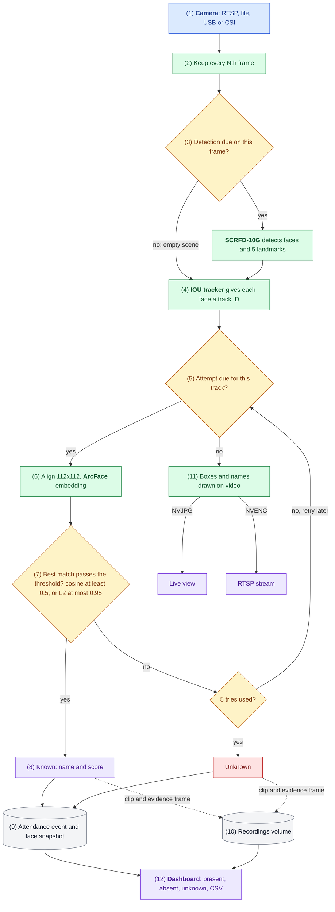
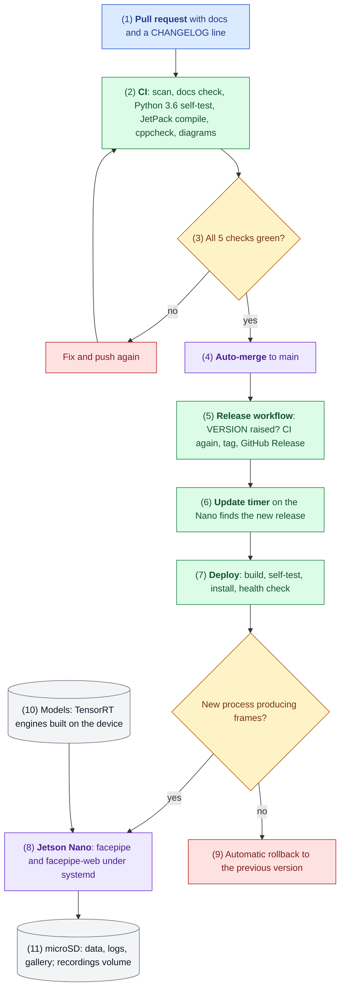

<div align="center">

# Jetson Nano Face Recognition Attendance System

**Edge AI attendance that runs entirely on a $99-class board: camera in, verified attendance out. No server, no cloud, no data leaving the device.**


<br>
[](https://github.com/hamza-aziz-ai/Jetson-Nano-Face-Recognition-Attendance-System/actions/workflows/ci.yml)
[](https://github.com/hamza-aziz-ai/Jetson-Nano-Face-Recognition-Attendance-System/releases)


[Overview](#overview) · [System Design](#system-design) · [Solution Architecture](#solution-architecture) · [Performance](#performance) · [Quick start](#quick-start) · [Documentation](#documentation)

</div>

---

## Overview

A production-grade, fully offline face recognition attendance system for the **NVIDIA Jetson Nano 4 GB**. Video decoding, face detection, tracking, recognition, the attendance record, evidence capture, live streaming and the web dashboard all run on the device itself.

It is a native C++ DeepStream application with custom TensorRT post-processing, and it puts every fixed-function engine on the Nano to work: **NVDEC** decodes the camera, the **VIC** scales frames for the detector, **NVJPG** produces the live view and evidence images, and **NVENC** encodes the RTSP stream and event clips, leaving the GPU for the neural networks.

### At a glance

| | |
| --- | --- |
| **15 fps** | end to end on a 1080p camera, with on-screen overlay, live view, RTSP and clips running |
| **~0% GPU at idle** | adaptive detection: every frame while people are present, every 6th frame in an empty scene |
| **0.97-0.99** | embedding agreement (cosine) with a server-side InsightFace reference on the same images |
| **4 camera types** | RTSP/IP, video files, CSI (Raspberry Pi HQ, IMX477) and USB (UVC MJPEG) |
| **0 bytes to the cloud** | faces, embeddings and recordings never leave the device |
| **Hands-off releases** | a new release installs itself within about 11 minutes: built, self-tested and health-checked on the device, with automatic rollback |

### Why it matters

- **No infrastructure.** One credit-card-sized board replaces a recognition server, a video server and a database for a single entrance.
- **Privacy by design.** Biometric data stays on the device, behind logins, with a documented threat model and data inventory.
- **Built to run unattended.** systemd supervision, a frame watchdog, clean shutdown, storage rotation, daily logs and self-updating releases with rollback.
- **Evidence for every decision.** Each attendance event comes with a face snapshot, a full-frame image with the name drawn, and a short video clip.

## Capabilities

| Area | What it does |
| --- | --- |
| 🎥 **Video sources** | RTSP/IP cameras (forced to TCP), video files, **CSI** cameras through the Argus ISP, **USB** cameras (MJPEG decoded on NVJPG, or raw YUY2) |
| 🔍 **Detection** | SCRFD-10G at 640x384 in TensorRT FP16 with a custom decoder for boxes and 5 facial landmarks; adaptive rate: full rate while faces are present, every 6th frame when the scene is empty |
| 🧭 **Tracking** | NvMultiObjectTracker (IOU): one recognition per person per visit, not per frame |
| 🧠 **Recognition** | Umeyama alignment to the ArcFace 5-point template, `w600k_r50` embeddings, cosine or L2 matching; unknown tracks retried up to 5 times |
| 👤 **Enrollment** | Photos in `gallery/<name>/`, one command; the running service hot-reloads the gallery |
| 📋 **Attendance** | Per-day event log with first and last seen, sightings, match score and a face snapshot; CSV export |
| 🎬 **Evidence** | Per event: a 1080p image with box and name (NVJPG) and an H.264 clip around the event (NVENC); weekly rotation when storage fills |
| 📡 **Live video** | Boxes and names drawn on the video; MJPEG live view in the dashboard (encoded only while watched) and an RTSP stream for VLC or an NVR |
| 🖥️ **Website** | Overview, Live, Attendance, People and System pages; present, absent and unknown per day, search and sort, CSV and print; start, stop and restart recognition; Python standard library only, works offline |
| 🔐 **Security** | PBKDF2-hashed login, separate RTSP login, Content-Security-Policy with per-response nonces, CI that blocks secrets, private IPs and biometric files |
| ⚙️ **Operations** | Frame watchdog, bounded clean shutdown, daily rotated logs, automatic updates with health check and rollback |

## System Design

How to read it: solid arrows are the path every face takes, dotted arrows are side writes; blue is the entry point, green a step, amber a decision, purple an outcome, red an error path, grey stored data ([legend](docs/FLOW.md#how-to-read-the-diagrams)). Numbers match the notes below.



1. **Camera input.** `FACEPIPE_URI` selects an RTSP camera (forced to TCP), a video file, a USB camera (MJPEG decoded on NVJPG) or a CSI camera (Argus ISP). Decoding runs on the hardware decoders, not the CPU.
2. **Frame thinning.** Only every Nth frame enters the pipeline (`FACEPIPE_DROP`, default 2: 15 fps from a 30 fps camera) (D-007).
3. **Adaptive detection.** SCRFD-10G runs at 640x384 in TensorRT FP16 from a probe: the VIC letterboxes the frame and a custom decoder keeps the 5 facial landmarks that alignment needs, with score 0.6 and NMS 0.4 (D-002, D-006). It runs on every frame while a face was seen in the last 10 s and on every 6th frame otherwise; the video itself always stays at full rate (D-028).
4. **Tracking.** The IOU tracker follows each face, so a person is recognized once per visit, not once per frame (D-004).
5. **Attempt rule.** A track gets a recognition attempt when it is not done, nothing is pending, the face is at least 40 px wide and 8 frames have passed since its last try (D-005).
6. **Embedding.** The face is aligned to the ArcFace 5-point template and `w600k_r50` turns it into 512 numbers, in RGB (D-008).
7. **Match.** The closest enrolled photo must pass the threshold of the metric chosen by `FACEPIPE_METRIC`: cosine similarity at least `FACEPIPE_MATCH` (default 0.5), or L2 distance at most `FACEPIPE_L2_MATCH` (default 0.95), the same pair of settings as the companion CCTV system (D-018, D-025). Below it, the track is retried up to 5 times, then recorded as Unknown.
8. **Known.** The label turns green with the name and score. The gallery reloads by itself after enrollment.
9. **Attendance record.** One JSON line per visit goes into the day's `events-YYYY-MM-DD.jsonl`, with a 112x112 face snapshot (D-009).
10. **Evidence.** A clip around the event (NVENC) and a full-frame image with the name drawn (NVJPG) go to the recordings volume, which drops its oldest week at 90% full (D-014, D-015). Without the volume, the event is still recorded.
11. **Live video.** Every frame is drawn with boxes and labels (amber while recognizing, green known, red unknown) for the dashboard live view, encoded only while someone watches, and for the RTSP stream; both need a login (D-011, D-012).
12. **Dashboard.** Who is present, absent and unknown for any day, with evidence links, live status and CSV export.

Each step is traced to the code in [docs/FLOW.md](docs/FLOW.md).

## Solution Architecture

How to read it: solid arrows are the path every change takes, red boxes are the failure and rollback paths; colours as above. Numbers match the notes below.



1. **Change.** Code, workflows, deploy scripts and configuration change through a branch and a pull request with a Conventional Commit title; docs-only changes go straight to main. Every change updates the affected docs and the CHANGELOG (D-032).
2. **CI.** GitHub Actions runs a scan that blocks secrets, private IPs and biometric files; a docs-with-code check; the web self-test on Python 3.6 (the version on the Nano); a `-Werror` compile of both binaries against checksum-pinned JetPack 4.6 headers, plus cppcheck; and a render of every Mermaid diagram (D-020 to D-022).
3. **Gate.** `main` is protected by the five checks. CI has caught real bugs this way, for example an enrollment file leak and crash ([write-up](docs/bugs/enroll-leak-and-crash.md)).
4. **Merge.** Pull requests merge themselves (squash) once every check passes.
5. **Release.** A merged change that raises `VERSION` makes the release workflow run CI again, tag `vX.Y.Z` on that commit and publish the GitHub Release with the CHANGELOG section. Nobody tags by hand (D-023, D-032).
6. **Delivery.** A systemd timer on the Nano checks the public release list every 10 minutes; no token or inbound access is needed (D-031).
7. **Deploy.** `deploy/deploy.sh` builds the tag on the Nano with `make all` (linking against the JetPack libraries on the device), runs the self-tests, installs over the app folder while keeping configuration, data and models, and restarts the services.
8. **On the device.** `facepipe` (pipeline) and `facepipe-web` (dashboard) run under systemd, restart on failure and reconnect to the camera.
9. **Rollback.** Healthy means the new process itself (its systemd `MainPID`) reports advancing frames; otherwise the previous version is restored and the release is not retried (D-029).
10. **Models.** TensorRT engines are built on the Nano itself with `trtexec`, because an engine is tied to the GPU and TensorRT version it was built on.
11. **Storage.** Code, models, data, logs and the gallery live on the microSD; clips and evidence go to a size-capped 64 GB volume.

Who owns which part, the ports and the data locations are in [docs/ARCHITECTURE.md](docs/ARCHITECTURE.md).

## Hardware utilisation

| Engine | Used for |
| --- | --- |
| **NVDEC** | Decoding RTSP and file video (H.264/H.265) |
| **VIC** | Letterboxing each frame to the detector's 640x384 input |
| **GPU** (128 Maxwell cores) | SCRFD and ArcFace in TensorRT FP16, colour conversion, overlay |
| **NVJPG** | Live view and evidence JPEGs; decoding USB webcams' MJPEG |
| **NVENC** | H.264 for the RTSP stream and event clips |
| **ISP** | CSI camera capture through Argus |
| **CPU** (4x A57) | Landmark decoding, alignment, tracking, the dashboard |

## Performance

Measured on a Jetson Nano 4 GB, MAXN power mode, JetPack 4.6.6.

| Configuration | Result |
| --- | --- |
| 30 fps 1080p camera, every 2nd frame processed, all outputs on | **15.0 fps** |
| Same, face present (detection every frame) | 15.0 fps, 15 detections/s |
| Same, empty scene (adaptive detection) | 15.0 fps, 2.4 detections/s, GPU about 0% between detections |
| Empty scene before adaptive detection (v1.0.3) | 12.2 fps, GPU 89-99% |
| Temperature, empty scene, after 1 minute (CPU sensor) | 82 °C before, 77 °C after adaptive detection |
| 1080p H.264 file, detector on every frame, no video outputs | 19.2 fps (GPU bound) |
| SCRFD-10G 640x384, TensorRT FP16 | 55 ms per frame |
| ArcFace w600k_r50, batch 1, TensorRT FP16 | 48 ms per face |
| Enrollment, 10 photos | 10 s |
| Embedding agreement with the InsightFace reference, same images | cosine 0.97-0.99 |
| Live match of an enrolled person against their gallery | cosine 0.62-0.78 (threshold 0.5) |
| Clean service stop (camera released, clip finalized) | 0.6 s |

## Reliability and operations

- **Watchdog.** If no frame arrives for `FACEPIPE_WATCHDOG` seconds (default 60), the process exits and systemd restarts it.
- **Clean shutdown.** A stop releases the camera, finishes queued recognitions and finalizes the open clip within 10 s, or is forced. This fixed a camera daemon that wedged when a capturing process was killed ([write-up](docs/bugs/csi-start-stall.md)).
- **Logs.** `logs/<year>/<Month>/facepipe.log`, `web.log` and `update.log`, one file per day, rotated at midnight to `<module>.log.DD-Mon-YYYY`. Lines read `[06-11-2026] 09:41:07.123 PM, Friday [INFO] ...` (D-030).
- **Automatic updates.** New releases install themselves within 10 minutes, with health check and rollback; a failed release is never retried and the version never goes backwards (D-031).
- **Storage.** The recordings volume drops its oldest week when 90% full; recording turns itself off when the volume is missing.

## Security and privacy

- Biometric data (photos, embeddings, snapshots, recordings) stays on the device.
- The dashboard and the RTSP stream each need a login; passwords are stored as PBKDF2 hashes (RTSP needs its password in a mode-0600 file).
- The dashboard uses plain HTTP: run it on a trusted network or behind a TLS reverse proxy.
- `web_auth`, `rtsp_auth`, `facepipe.env`, `data/`, `gallery/` and `logs/` are git-ignored, and CI fails on secrets, private IPs, personal paths and biometric files.
- Threat model: [docs/THREAT.md](docs/THREAT.md). Data inventory and retention: [docs/DATA.md](docs/DATA.md).

## Quick start

**Requirements:** Jetson Nano 4 GB with JetPack 4.6.x (L4T 32.7), DeepStream 6.0.1, TensorRT 8.2 and CUDA 10.2; a 5V 4A power supply and a fan for continuous MAXN operation; the two InsightFace models below (check their license before commercial use).

1. **Get the code and models.** Clone the repository on the Nano into the folder the app should live in, and put two models in `models/`:
   - `w600k_r50.onnx` from InsightFace's `buffalo_l` pack;
   - `scrfd_10g_384x640.onnx`: take `scrfd_10g_gnkps.onnx` from the InsightFace-REST model zoo and fix its input on any PC with `python3 tools/reshape_scrfd.py scrfd_10g_gnkps.onnx models/scrfd_10g_384x640.onnx` (needs `pip install onnx`).
2. **Install.** `sh deploy/install.sh` builds both binaries, builds the TensorRT engines on the device (about 15 minutes, once), runs the self-tests, creates `facepipe.env`, and installs and starts the services and the update timer as the current user, from this folder. Re-running it is safe; `--no-service` stops before the services.
3. **Choose the camera.** In `facepipe.env`, set `FACEPIPE_URI` (`rtsp://...`, `usb:/dev/video0`, `csi:0` or a file) and, if the system clock is UTC, `TZ`. Then `sudo systemctl restart facepipe`.
4. **Set the logins.** `python3 web.py --set-password <user>` for the dashboard; optionally `python3 web.py --set-rtsp-password <user>` (without it the RTSP server stays off).
5. **Enroll people.** Create `gallery/<person_name>/` with a few clear photos each (front, slight left, slight right), then run `./facepipe-enroll gallery`. A photo named `profile.jpg` becomes the person's picture on the website.
6. **Open the dashboard** at `http://<nano>:8000`. Logs are in `logs/`; `sudo journalctl -u facepipe -f` shows the same lines live.

<details>
<summary><b>Optional: recordings volume for clips and evidence</b></summary>

A 64 GB ext4 image file on the microSD:

```sh
sudo fallocate -l 64G /var/lib/facepipe-rec.img
sudo mkfs.ext4 -q -L facepipe-rec -m 0 /var/lib/facepipe-rec.img
sudo mkdir -p /mnt/rec
echo '/var/lib/facepipe-rec.img /mnt/rec ext4 loop,nofail,noatime 0 2' | sudo tee -a /etc/fstab
sudo mount /mnt/rec && sudo chown $USER:$USER /mnt/rec
```

</details>

<details>
<summary><b>Configuration reference</b></summary>

All settings are environment variables in `facepipe.env`; `facepipe.env.example` lists them with comments.

| Variable | Default | Meaning |
| --- | --- | --- |
| `FACEPIPE_URI` | | `rtsp://...`, `file://...`, `csi:0`, `usb:/dev/video0` |
| `FACEPIPE_DROP` | `2` | process every Nth frame; keep camera fps / N at or below about 19 on a Nano |
| `FACEPIPE_METRIC` | `cosine` | `cosine` or `l2` for face matching |
| `FACEPIPE_MATCH` | `0.5` | cosine threshold: match when similarity is at least this |
| `FACEPIPE_L2_MATCH` | `0.95` | L2 threshold: match when distance is at most this |
| `FACEPIPE_IDLE_AFTER` | `10` | seconds without a face before detecting less often; `0` = always every frame |
| `FACEPIPE_IDLE_STEP` | `6` | while idle, detect on every Nth frame |
| `FACEPIPE_WATCHDOG` | `60` | seconds without frames before the process exits and restarts; `0` = off |
| `FACEPIPE_REC` | `/mnt/rec` | recordings volume; recording turns itself off when it is not writable |
| `FACEPIPE_LOGS` | `logs/` in the app folder | log folder |
| `FACEPIPE_USB_FORMAT` | `mjpeg` | `mjpeg` or `raw` for USB cameras |
| `FACEPIPE_CAM_FPS` | `30` | capture rate for CSI and USB cameras |
| `FACEPIPE_REPO` | this repository | GitHub repository the update timer follows |

A custom OpenCV build (for example with CUDA) instead of the system one: `make all OPENCV_PC=<its lib/pkgconfig>`.

</details>

## Validation status

Every row was verified on a Jetson Nano 4 GB with real cameras; [docs/TEST-CHECKLIST.md](docs/TEST-CHECKLIST.md) has the commands and output.

| Feature | Status |
| --- | --- |
| RTSP camera input, detection, tracking, recognition, enrollment | ✅ Verified with a live camera |
| USB camera input | ✅ Logitech C270, MJPEG 1280x720 decoded on NVJPG, enrolled person recognized |
| CSI camera input | ✅ Raspberry Pi HQ Camera (IMX477, R8 removed), 15 fps with all outputs, recognized at cosine 0.62-0.69 |
| Attendance log, dashboard, CSV, login | ✅ Verified |
| Event clips and full-frame evidence | ✅ About 8 s clips with 3 s before the event, and 1080p evidence with the name drawn |
| RTSP stream | ✅ Plays in VLC with the RTSP login |
| Adaptive detection | ✅ Same boxes and embeddings as before on identical frames (cosine 1.0000); 15 fps empty and occupied |
| Clean shutdown, watchdog, daily logs | ✅ Verified |
| Automatic update with health check | ✅ v1.1.1 deployed itself, healthy after 22 s |
| Website and service control | ✅ 5 pages with real data; Restart from the System page restarted the service cleanly |

## Roadmap

Agreed in a design review (D-033): **v1.2** multi-page website with live view and service control (done) · **v1.3** self-registration by invitation with admin approval · **v1.4** video upload with annotated output, queued beside live · **v1.5** two cameras with enable and disable.

## Engineering notes

<details>
<summary><b>Problems found and solved while building this, each verified on the device</b></summary>

- **Tracker silently dropped all faces.** With raw tensor output, `NvDsFrameMeta.bInferDone` was unset and `nvtracker` ignored the frame's detections; the detection probe sets it.
- **Embedding mismatch traced to a reference server bug.** Comparing against an FP32 ONNX run of the same crop showed the reference InsightFace-REST TensorRT backend fed ArcFace BGR instead of RGB (cosine 0.935 vs 1.000). Reported upstream in the companion project and fixed there.
- **Camera daemon wedged after a killed capture.** `nvargus-daemon` logged SCF timeouts and refused every later client until restarted; a bounded clean shutdown prevents it.
- **Detection rate could not change while playing.** `nvinfer`'s `interval` is fixed outside NULL/READY, so detection moved into a probe with its own engine and a VIC letterbox, with identical results.
- **`nvjpegenc` crash.** On JetPack 4.6 it segfaults on DeepStream `NvBufSurface` buffers; frames are converted to system-memory I420 first.
- **libjpeg ABI clash.** OpenCV `imgcodecs` and the L4T JPEG library cannot share a process ("JPEG parameter struct mismatch: library thinks size is 584, caller expects 728"), so enrollment is a separate binary.
- **Wi-Fi camera at 4-5 fps.** RTSP over UDP lost packets on Wi-Fi; forcing TCP gave a steady 30 fps.
- **USB webcam at half speed.** UVC cameras trade frame rate for exposure in dim light; the source sets `exposure_auto_priority=0`.
- **Empty or short event clips.** The encoder made an IDR keyframe only every 256 frames, so clips usually started without SPS/PPS and the parser dropped frames; every keyframe is now an IDR.
- **"Text file busy" on deploy.** Copying over a running binary fails; files are copied beside it and renamed.
- **Missing development headers.** `gst-rtsp-server` ships only its runtime library on JetPack 4.6, so the few calls used are declared directly.

Every bug has a write-up in [docs/bugs/](docs/bugs/).

</details>

## Documentation

| | |
| --- | --- |
| [Architecture](docs/ARCHITECTURE.md) | Runtime topology, delivery, ownership, ports, data locations |
| [Flow of one face](docs/FLOW.md) | Every step traced to the code |
| [Decisions](docs/DECISIONS.md) · [Alternatives](docs/ALTERNATIVES.md) | 33 recorded decisions with options, trade-offs and when to revisit |
| [Threat model](docs/THREAT.md) · [Data](docs/DATA.md) | Security and biometric data handling |
| [Failure map](docs/FAILURE.md) · [Rollback](docs/ROLLBACK.md) | What breaks, how it shows, how it recovers |
| [Test checklist](docs/TEST-CHECKLIST.md) · [Assumptions](docs/ASSUMPTIONS.md) | Evidence behind every claim |
| [Releasing](docs/RELEASING.md) · [Changelog](CHANGELOG.md) | Release flow and history |
| [Bugs](docs/bugs/) · [Features](docs/features/) | One write-up each |

## Repository layout

| Path | Purpose |
| --- | --- |
| `facepipe.cpp` | DeepStream pipeline, detection probe and SCRFD decoding, alignment, recognition worker, video outputs, RTSP server, logging, enrollment (`-DFACEPIPE_ENROLL`) |
| `web.py`, `web/` | Website (5 pages, service control), CSV export, live MJPEG view, evidence files, login management |
| `facepipe.env.example` | All runtime settings |
| `deploy/install.sh` | One-step install: build, engines, self-tests, `facepipe.env`, services and update timer for the current user and folder |
| `deploy/deploy.sh`, `deploy/update.sh` | Release deploy with health check and rollback; the automatic update check |
| `deploy/*.in` | systemd unit templates (filled in by `install.sh`) |
| `tools/reshape_scrfd.py` | Makes the 640x384 SCRFD model from the InsightFace-REST model zoo file |
| `check_vs_rest.py` | Verifies embeddings against an InsightFace-REST server |
| `Makefile` | Builds both binaries; `make check` compiles without linking (CI) |
| `ci/`, `.github/workflows/` | CI checks and the release workflow |
| `CLAUDE.md`, `AGENTS.md`, `MEMORY.md` | Instructions and current state for AI coding agents |

## Limitations

- One camera per Nano today (two are planned for v1.5); the GPU caps detection at about 19 fps at 640x384.
- An upside-down face is detected but not recognized; flip the image for cameras mounted upside down.
- Plain HTTP dashboard: use a trusted network or a TLS proxy.

---

<div align="center">

**Hamza Aziz** · [GitHub](https://github.com/hamza-aziz-ai)

Companion project: [CCTV Face Recognition Attendance System](https://github.com/hamza-aziz-ai/CCTV-Face-Recognition-Attendance-System), the multi-camera server version.

</div>
