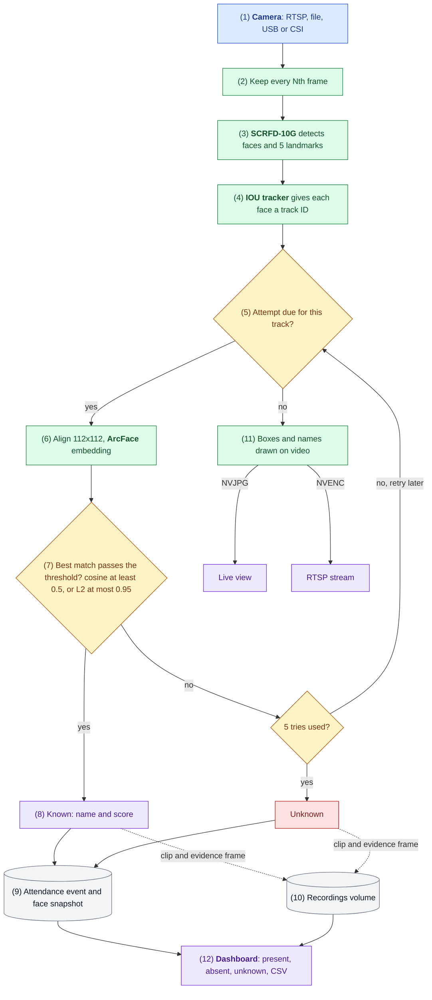
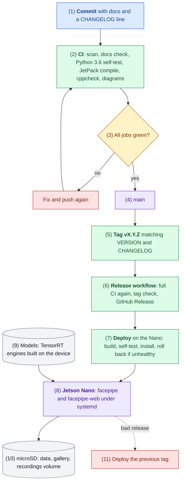

# Jetson Nano Face Recognition Attendance System


[](https://github.com/hamza-aziz-ai/Jetson-Nano-Face-Recognition-Attendance-System/actions/workflows/ci.yml)
[](https://github.com/hamza-aziz-ai/Jetson-Nano-Face-Recognition-Attendance-System/releases)

A standalone, fully offline face recognition attendance system that runs entirely on an **NVIDIA Jetson Nano 4 GB**. One camera in, attendance out: video decoding, face detection, tracking, recognition, the attendance log, evidence capture and a web dashboard all run on the device, with no server and no cloud.

It is built as a native C++ DeepStream application with custom TensorRT post-processing, and it uses all of the Nano's fixed-function video hardware: **NVDEC** to decode the camera, **NVJPG** for the live view and evidence images, and **NVENC** for the RTSP stream and event clips.

## System Design

How to read it: solid arrows are the path every face takes, dotted arrows are side writes; blue is the entry point, green a step, amber a decision, purple an outcome, red an error path, grey stored data ([legend](docs/FLOW.md#how-to-read-the-diagrams)). Numbers match the notes below.



1. **Camera input.** `FACEPIPE_URI` selects an RTSP camera (forced to TCP), a video file, a USB camera (MJPEG decoded on NVJPG) or a CSI camera (Argus ISP). Decoding runs on the hardware decoders, not the CPU.
2. **Frame thinning.** Only every Nth frame enters the pipeline (`FACEPIPE_DROP`, default 2: 15 fps from a 30 fps camera). The GPU tops out at about 19 fps of detection (D-007).
3. **Detection.** SCRFD-10G runs at 640x384 in TensorRT FP16. A custom decoder keeps the 5 facial landmarks that alignment needs, with score 0.6 and NMS 0.4 (D-002, D-006).
4. **Tracking.** The IOU tracker follows each face, so a person is recognized once per visit, not once per frame (D-004).
5. **Attempt rule.** A track gets a recognition attempt when it is not done, nothing is pending, the face is at least 40 px wide and 8 frames have passed since its last try (D-005).
6. **Embedding.** The face is aligned to the ArcFace 5-point template and `w600k_r50` turns it into 512 numbers, in RGB (D-008).
7. **Match.** The closest enrolled photo must pass the threshold of the metric chosen by `FACEPIPE_METRIC`: cosine similarity at least `FACEPIPE_MATCH` (default 0.5, the default metric), or L2 distance at most `FACEPIPE_L2_MATCH` (default 0.95), the same pair of settings as the CCTV system (D-018, D-025). Below it, the track is retried up to 5 times, then recorded as Unknown.
8. **Known.** The label turns green with the name and score. The gallery reloads by itself after enrollment.
9. **Attendance record.** One JSON line per visit goes into the day's `events-YYYY-MM-DD.jsonl`, with a 112x112 face snapshot (D-009).
10. **Evidence.** A clip from 3 s before to 5 s after the event (NVENC) and a full-frame image with the name drawn (NVJPG) go to the recordings volume, which drops its oldest week at 90% full (D-014, D-015). If the volume is missing, the event is still recorded without them.
11. **Live video.** Every frame is drawn with boxes and labels (amber while recognizing, green known, red unknown) for the dashboard live view, encoded only while someone watches, and for the RTSP stream; both need a login (D-011, D-012).
12. **Dashboard.** The web page shows who is present, absent and unknown for any day, with evidence links, live status and CSV export.

Each step is traced to the code in [docs/FLOW.md](docs/FLOW.md).

## Solution Architecture

How to read it: solid arrows are the path every change takes, red boxes are the failure and rollback paths; colours as above. Numbers match the notes below.



1. **Change.** Every change updates the affected docs and adds a line under `[Unreleased]` in `CHANGELOG.md` in the same commit.
2. **CI.** GitHub Actions runs on every push and pull request: a scan that blocks secrets, private IPs and biometric files; a docs-with-code check; the web self-test on Python 3.6 (the version on the Nano); a `-Werror` compile of both binaries against checksum-pinned JetPack 4.6 headers, plus cppcheck; and a render of every Mermaid diagram (D-020 to D-022).
3. **Gate.** A red job blocks the change. CI caught a real bug this way: an enrollment file leak and crash (`docs/bugs/enroll-leak-and-crash.md`).
4. **Main.** Only green commits are released.
5. **Version.** The `VERSION` file follows Semantic Versioning and is compiled into the binaries, `status.json` and the dashboard footer (D-023).
6. **Release.** Pushing a `vX.Y.Z` tag reruns the full CI, checks that the tag matches `VERSION` and has a changelog section, and publishes the GitHub Release with those notes.
7. **Deploy.** `deploy/deploy.sh` builds the tag on the Nano with `make all` (linking against the JetPack libraries on the device), runs the self-tests, installs over the app folder while keeping configuration, data and models, restarts the services and rolls back if the new version is not healthy within 60 s. A Deploy to Nano workflow runs the same script on a self-hosted runner and uploads the release assets; it stays switched off until a runner is registered (D-026).
8. **On the device.** `facepipe` (pipeline) and `facepipe-web` (dashboard) run under systemd, restart on failure and reconnect to the camera.
9. **Models.** TensorRT engines are built on the Nano itself with `trtexec`, because an engine is tied to the GPU and TensorRT version it was built on.
10. **Storage.** Code, models, data and the gallery live on the microSD; clips and evidence go to a size-capped 64 GB volume.
11. **Rollback.** Releases are never edited; going back means deploying the previous tag (`docs/ROLLBACK.md`).

Who owns which part, the ports and the data locations are in [docs/ARCHITECTURE.md](docs/ARCHITECTURE.md).

## Highlights

- **Real-time on a 5-10 W board:** 15 fps end to end on a 1080p camera, with detection on every processed frame.
- **Recognition you can trust:** 5-point landmark alignment and ArcFace embeddings that agree with a server-side InsightFace reference at cosine 0.97-0.99 on the same images.
- **Built for unattended operation:** systemd services that reconnect to cameras and restart on failure, a live health badge, storage rotation.
- **Privacy by design:** faces, embeddings and recordings never leave the device; dashboard and video stream are behind logins.

## Features

| Area | What it does |
| --- | --- |
| Video sources | RTSP/IP cameras (forced to TCP), video files, **CSI** cameras through the Argus ISP, **USB** cameras (MJPEG decoded on NVJPG, or raw YUY2) |
| Detection | SCRFD-10G at 640x384, TensorRT FP16, custom decoder for boxes and 5 facial landmarks, NMS |
| Tracking | NvMultiObjectTracker (IOU): one recognition per person per visit, not per frame |
| Recognition | Umeyama similarity alignment to the ArcFace 5-point template, `w600k_r50` embeddings, cosine matching; unknown tracks are retried up to 5 times |
| Enrollment | Drop photos in `gallery/<name>/`, run `facepipe-enroll`; the running service hot-reloads the gallery |
| Attendance | Per-day event log with first/last seen, sightings, match score and a face snapshot |
| Evidence | Per event: a full-frame 1080p image with box and name (NVJPG) and an H.264 clip from 3 s before to 5 s after (NVENC), with automatic weekly rotation when storage fills |
| Live video | On-screen boxes and names (`nvdsosd`); MJPEG live view in the dashboard, encoded only while someone is watching; RTSP stream for VLC or an NVR |
| Dashboard | Present / absent / unknown per day, live status, search and sort, CSV export, print layout; Python standard library only, works offline |
| Security | PBKDF2-hashed dashboard login, separate RTSP login, Content-Security-Policy with per-response nonces, no secrets in the repository |

## Performance

Measured on a Jetson Nano 4 GB, MAXN power mode, JetPack 4.6.6.

| Configuration | Result |
| --- | --- |
| 1080p H.264, detector on every frame, no video outputs | 19.2 fps (GPU bound) |
| 30 fps 1080p camera, every 2nd frame processed (default) | 15.0 fps |
| Same, with overlay, NVJPG live view and NVENC encoding | 13-15 fps |
| SCRFD-10G 640x384, TensorRT FP16 | 55 ms per frame |
| ArcFace w600k_r50, batch 1, TensorRT FP16 | 48 ms per face |
| Enrollment, 10 photos | 10 s |
| Embedding agreement with InsightFace reference, same images | cosine 0.97-0.99 |
| Live match of an enrolled person against their gallery | cosine 0.68-0.78 (threshold 0.5) |

## Engineering notes

Problems found and solved while building this, each verified on the device:

- **Tracker silently dropped all faces.** With `network-type=100` (raw tensor output), `nvinfer` leaves `NvDsFrameMeta.bInferDone` unset, and `nvtracker` then ignores the frame's detections. The detection probe sets it.
- **Embedding mismatch traced to a reference server bug.** Comparing against an FP32 ONNX run of the same crop showed the reference InsightFace-REST TensorRT backend fed ArcFace BGR instead of RGB (cosine 0.935 vs 1.000). Reported upstream in the companion project and fixed there; this pipeline uses RGB.
- **`nvjpegenc` crash.** On JetPack 4.6 it segfaults on DeepStream `NvBufSurface` buffers; frames are converted to system-memory I420 first.
- **libjpeg ABI clash.** OpenCV `imgcodecs` and the L4T JPEG library cannot share a process ("JPEG parameter struct mismatch: library thinks size is 584, caller expects 728"), so the live binary avoids `imgcodecs` and enrollment is a separate binary.
- **Wi-Fi camera at 4-5 fps.** RTSP over UDP lost packets on Wi-Fi; forcing TCP gave a steady 30 fps.
- **USB webcam at half speed.** UVC cameras trade frame rate for exposure in dim light (a C270 dropped from 30 to 15 fps); the source sets `exposure_auto_priority=0` to keep the rate steady.
- **Missing development headers.** `gst-rtsp-server` ships only its runtime library on JetPack 4.6, so the few API calls used are declared directly instead of installing extra packages.
- **Embedded landmarks through the tracker.** The 5 landmarks ride on each object in `misc_obj_info`, so alignment uses the detector's landmarks for the tracked face.

## Validation status

| Feature | Status |
| --- | --- |
| RTSP camera input, detection, tracking, recognition, enrollment | Verified on device with a live camera |
| Attendance log, dashboard, CSV, login | Verified |
| NVJPG live frames, NVENC encoding | Verified (encoders running in the service) |
| Event clips and full-frame evidence | Verified: clip H.264 1080p, 8.8 s, 133 frames; evidence 1080p JPEG with the name drawn |
| RTSP stream | Server verified (listening on 8554 with its login); playback in VLC not yet confirmed |
| USB camera input | Verified: Logitech C270, MJPEG 1280x720 decoded on NVJPG, enrolled person recognized |
| CSI camera input | Verified: Raspberry Pi HQ Camera (IMX477, R8 removed), 12.8-15 fps with all outputs, enrolled person recognized at cosine 0.62-0.69 |

## Documentation

Engineering documentation lives in [`docs/`](docs/): [architecture](docs/ARCHITECTURE.md), [flow of one face](docs/FLOW.md), [decisions](docs/DECISIONS.md) and [alternatives](docs/ALTERNATIVES.md), [threat model](docs/THREAT.md), [failure map](docs/FAILURE.md), [data](docs/DATA.md), [assumptions](docs/ASSUMPTIONS.md), [test checklist](docs/TEST-CHECKLIST.md), [rollback](docs/ROLLBACK.md), [handover](docs/HANDOVER.md), [releasing](docs/RELEASING.md) and the [changelog](CHANGELOG.md), and one write-up per [bug](docs/bugs/) and [feature](docs/features/).

## Getting started

### Requirements

- Jetson Nano 4 GB, JetPack 4.6.x (L4T 32.7), DeepStream 6.0.1, TensorRT 8.2, CUDA 10.2.
- OpenCV 4.x with `core`, `imgproc` and `imgcodecs` (set `OCV` and `OPENCV_PC` in the `Makefile`).
- Models from [InsightFace](https://github.com/deepinsight/insightface): SCRFD-10G with keypoints, reshaped to a fixed 1x3x384x640 input, and `w600k_r50`. Check the InsightFace model license before any commercial use.
- A 5V 4A power supply and a fan for continuous MAXN operation.

### Install

1. Clone the repository on the Nano into the folder you want the app in, and put the two models in `models/`:
   - `w600k_r50.onnx` from InsightFace's `buffalo_l` pack;
   - `scrfd_10g_384x640.onnx`: take `scrfd_10g_gnkps.onnx` from the InsightFace-REST model zoo and fix its input on any PC with `python3 tools/reshape_scrfd.py scrfd_10g_gnkps.onnx models/scrfd_10g_384x640.onnx` (needs `pip install onnx`).
2. Run `sh deploy/install.sh`. It builds both binaries against the system OpenCV, builds the TensorRT engines on the device (about 15 minutes, once), runs the self-tests, creates `facepipe.env` from the example, and installs and starts the two systemd services as the current user, from this folder. `sh deploy/install.sh --no-service` stops before the services. Re-running it is safe.
3. Edit `facepipe.env`: set `FACEPIPE_URI` to your camera (`rtsp://...`, `usb:/dev/video0`, `csi:0` or a file) and, if the clock is UTC, `TZ`. Then `sudo systemctl restart facepipe`.
4. Set the dashboard login: `python3 web.py --set-password <user>`; optionally the RTSP login: `python3 web.py --set-rtsp-password <user>` (without it the RTSP server stays off).
5. Enroll people: create `gallery/<person_name>/` with a few clear photos each (front, slight left, slight right), then `./facepipe-enroll gallery`.
6. Optional recordings volume for event clips and evidence, for example a 64 GB ext4 image file:
   ```sh
   sudo fallocate -l 64G /var/lib/facepipe-rec.img
   sudo mkfs.ext4 -q -L facepipe-rec -m 0 /var/lib/facepipe-rec.img
   sudo mkdir -p /mnt/rec
   echo '/var/lib/facepipe-rec.img /mnt/rec ext4 loop,nofail,noatime 0 2' | sudo tee -a /etc/fstab
   sudo mount /mnt/rec && sudo chown $USER:$USER /mnt/rec
   ```
7. Open `http://<nano>:8000`. Logs: `sudo journalctl -u facepipe -f`. Updates: `sh deploy/deploy.sh vX.Y.Z <app folder>` builds, tests and installs a release, and rolls back if it is unhealthy.

Using a custom OpenCV build (for example with CUDA) instead of the system one: `make all OPENCV_PC=<its lib/pkgconfig>`.

### Configuration

All settings are environment variables in `facepipe.env`; `facepipe.env.example` lists them with comments.

| Variable | Default | Meaning |
| --- | --- | --- |
| `FACEPIPE_URI` | | `rtsp://...`, `file://...`, `csi:0`, `usb:/dev/video0` |
| `FACEPIPE_DROP` | `2` | process every Nth frame; keep camera fps / N at or below about 19 on a Nano |
| `FACEPIPE_METRIC` | `cosine` | `cosine` or `l2` for face matching |
| `FACEPIPE_MATCH` | `0.5` | cosine threshold: match when similarity is at least this |
| `FACEPIPE_L2_MATCH` | `0.95` | L2 threshold: match when distance is at most this |
| `FACEPIPE_REC` | `/mnt/rec` | recordings volume; recording turns itself off when it is not writable |
| `FACEPIPE_USB_FORMAT` | `mjpeg` | `mjpeg` or `raw` for USB cameras |
| `FACEPIPE_CAM_FPS` | `30` | capture rate for CSI and USB cameras |

## Repository layout

| File | Purpose |
| --- | --- |
| `facepipe.cpp` | DeepStream pipeline, SCRFD decoding, alignment, recognition worker, video outputs, RTSP server, enrollment (`-DFACEPIPE_ENROLL`) |
| `web.py` | Dashboard, CSV export, live MJPEG view, evidence files, login management |
| `pgie_scrfd.txt` | `nvinfer` configuration for the detector |
| `facepipe.env.example` | All runtime settings |
| `deploy/install.sh` | One-step install on a Nano: build, engines, self-tests, `facepipe.env`, systemd services for the current user and folder |
| `deploy/*.service.in` | systemd unit templates (filled in by `install.sh`) |
| `deploy/deploy.sh`, `deploy/upload-assets.py` | Release deploy with rollback, and release-asset upload |
| `tools/reshape_scrfd.py` | Makes the 640x384 SCRFD model from the InsightFace-REST model zoo file |
| `check_vs_rest.py` | Verifies embeddings against an InsightFace-REST server |
| `Makefile` | Builds both binaries; `make check` compiles without linking (CI) |
| `VERSION`, `CHANGELOG.md` | Current version and release notes (Semantic Versioning) |
| `ci/`, `.github/workflows/` | CI checks and the release workflow |
| `models/` | ONNX models and TensorRT engines (not in the repository) |

## Security and privacy

- Biometric data (photos, embeddings, snapshots, recordings) stays on the device.
- The dashboard uses HTTP Basic auth over plain HTTP: use it on a trusted network, or put a TLS reverse proxy in front.
- `web_auth`, `rtsp_auth`, `facepipe.env`, `data/` and `gallery/` are excluded by `.gitignore` and must never be committed.

## Limitations

- One camera per Nano; the GPU caps detection at about 19 fps at 640x384.
- An upside-down face is detected but not recognized (its landmarks are mislabeled); flip the image for cameras mounted upside down.

## Author

**Hamza Aziz** · [GitHub](https://github.com/hamza-aziz-ai)

Companion project: [CCTV-Face-Recognition-Attendance-System](https://github.com/hamza-aziz-ai/CCTV-Face-Recognition-Attendance-System), the multi-camera server version.
