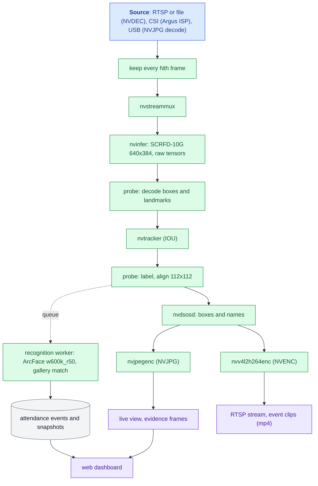

# Jetson Nano Face Recognition Attendance System


A standalone, fully offline face recognition attendance system that runs entirely on an **NVIDIA Jetson Nano 4 GB**. One camera in, attendance out: video decoding, face detection, tracking, recognition, the attendance log, evidence capture and a web dashboard all run on the device, with no server and no cloud.

It is built as a native C++ DeepStream application with custom TensorRT post-processing, and it uses all of the Nano's fixed-function video hardware: **NVDEC** to decode the camera, **NVJPG** for the live view and evidence images, and **NVENC** for the RTSP stream and event clips.

## Highlights

- **Real-time on a 5-10 W board:** 15 fps end to end on a 1080p camera, with detection on every processed frame.
- **Recognition you can trust:** 5-point landmark alignment and ArcFace embeddings that agree with a server-side InsightFace reference at cosine 0.97-0.99 on the same images.
- **Built for unattended operation:** systemd services that reconnect to cameras and restart on failure, a live health badge, storage rotation.
- **Privacy by design:** faces, embeddings and recordings never leave the device; dashboard and video stream are behind logins.

## Features

| Area | What it does |
| --- | --- |
| Video sources | RTSP/IP cameras (forced to TCP), video files, **CSI** cameras through the Argus ISP, **USB** cameras (MJPEG decoded on NVJPG, or raw YUY2) |
| Detection | SCRFD-10G at 640x384, TensorRT FP16, custom decoder for boxes and 5 facial landmarks, NMS |
| Tracking | NvMultiObjectTracker (IOU): one recognition per person per visit, not per frame |
| Recognition | Umeyama similarity alignment to the ArcFace 5-point template, `w600k_r50` embeddings, cosine matching; unknown tracks are retried up to 5 times |
| Enrollment | Drop photos in `gallery/<name>/`, run `facepipe-enroll`; the running service hot-reloads the gallery |
| Attendance | Per-day event log with first/last seen, sightings, match score and a face snapshot |
| Evidence | Per event: a full-frame 1080p image with box and name (NVJPG) and an H.264 clip from 3 s before to 5 s after (NVENC), with automatic weekly rotation when storage fills |
| Live video | On-screen boxes and names (`nvdsosd`); MJPEG live view in the dashboard, encoded only while someone is watching; RTSP stream for VLC or an NVR |
| Dashboard | Present / absent / unknown per day, live status, search and sort, CSV export, print layout; Python standard library only, works offline |
| Security | PBKDF2-hashed dashboard login, separate RTSP login, Content-Security-Policy with per-response nonces, no secrets in the repository |

## Architecture



Blue: source, green: processing, purple: outputs, grey: stored data. The [flows](docs/FLOW.md) trace each step to the code.

## Performance

Measured on a Jetson Nano 4 GB, MAXN power mode, JetPack 4.6.6.

| Configuration | Result |
| --- | --- |
| 1080p H.264, detector on every frame, no video outputs | 19.2 fps (GPU bound) |
| 30 fps 1080p camera, every 2nd frame processed (default) | 15.0 fps |
| Same, with overlay, NVJPG live view and NVENC encoding | 13-15 fps |
| SCRFD-10G 640x384, TensorRT FP16 | 55 ms per frame |
| ArcFace w600k_r50, batch 1, TensorRT FP16 | 48 ms per face |
| Enrollment, 10 photos | 10 s |
| Embedding agreement with InsightFace reference, same images | cosine 0.97-0.99 |
| Live match of an enrolled person against their gallery | cosine 0.68-0.78 (threshold 0.5) |

## Engineering notes

Problems found and solved while building this, each verified on the device:

- **Tracker silently dropped all faces.** With `network-type=100` (raw tensor output), `nvinfer` leaves `NvDsFrameMeta.bInferDone` unset, and `nvtracker` then ignores the frame's detections. The detection probe sets it.
- **Embedding mismatch traced to a reference server bug.** Comparing against an FP32 ONNX run of the same crop showed the reference InsightFace-REST TensorRT backend fed ArcFace BGR instead of RGB (cosine 0.935 vs 1.000). Reported upstream in the companion project and fixed there; this pipeline uses RGB.
- **`nvjpegenc` crash.** On JetPack 4.6 it segfaults on DeepStream `NvBufSurface` buffers; frames are converted to system-memory I420 first.
- **libjpeg ABI clash.** OpenCV `imgcodecs` and the L4T JPEG library cannot share a process ("JPEG parameter struct mismatch: library thinks size is 584, caller expects 728"), so the live binary avoids `imgcodecs` and enrollment is a separate binary.
- **Wi-Fi camera at 4-5 fps.** RTSP over UDP lost packets on Wi-Fi; forcing TCP gave a steady 30 fps.
- **USB webcam at half speed.** UVC cameras trade frame rate for exposure in dim light (a C270 dropped from 30 to 15 fps); the source sets `exposure_auto_priority=0` to keep the rate steady.
- **Missing development headers.** `gst-rtsp-server` ships only its runtime library on JetPack 4.6, so the few API calls used are declared directly instead of installing extra packages.
- **Embedded landmarks through the tracker.** The 5 landmarks ride on each object in `misc_obj_info`, so alignment uses the detector's landmarks for the tracked face.

## Validation status

| Feature | Status |
| --- | --- |
| RTSP camera input, detection, tracking, recognition, enrollment | Verified on device with a live camera |
| Attendance log, dashboard, CSV, login | Verified |
| NVJPG live frames, NVENC encoding | Verified (encoders running in the service) |
| Event clips and full-frame evidence, RTSP playback | Implemented; end-to-end test pending |
| USB camera input | Verified: Logitech C270, MJPEG 1280x720 decoded on NVJPG, enrolled person recognized |
| CSI camera input | Implemented; pipeline builds and fails cleanly without a camera, hardware test pending |

## Documentation

Engineering documentation lives in [`docs/`](docs/): [architecture](docs/ARCHITECTURE.md), [flow of one face](docs/FLOW.md), [decisions](docs/DECISIONS.md) and [alternatives](docs/ALTERNATIVES.md), [threat model](docs/THREAT.md), [failure map](docs/FAILURE.md), [data](docs/DATA.md), [assumptions](docs/ASSUMPTIONS.md), [test checklist](docs/TEST-CHECKLIST.md), [rollback](docs/ROLLBACK.md), [handover](docs/HANDOVER.md), and one write-up per [bug](docs/bugs/) and [feature](docs/features/).

## Getting started

### Requirements

- Jetson Nano 4 GB, JetPack 4.6.x (L4T 32.7), DeepStream 6.0.1, TensorRT 8.2, CUDA 10.2.
- OpenCV 4.x with `core`, `imgproc` and `imgcodecs` (set `OCV` and `OPENCV_PC` in the `Makefile`).
- Models from [InsightFace](https://github.com/deepinsight/insightface): SCRFD-10G with keypoints, reshaped to a fixed 1x3x384x640 input, and `w600k_r50`. Check the InsightFace model license before any commercial use.
- A 5V 4A power supply and a fan for continuous MAXN operation.

### Install

1. Put the models in `models/` and build the TensorRT engines there, on the Nano itself:
   ```sh
   cd models
   trtexec --onnx=scrfd_10g_384x640.onnx --fp16 --workspace=1024 --saveEngine=scrfd_384x640_b1.plan
   trtexec --onnx=w600k_r50.onnx --fp16 --workspace=1024 --minShapes=input.1:1x3x112x112      --optShapes=input.1:8x3x112x112 --maxShapes=input.1:16x3x112x112 --saveEngine=r50_b16.plan
   ```
2. Build: `make all` (builds `facepipe` and `facepipe-enroll`, and copies the DeepStream sample IOU tracker config).
3. Configure: `cp facepipe.env.example facepipe.env` and set the camera and paths.
4. Enroll: create `gallery/<person_name>/` with a few clear photos each (front, slight left, slight right), then `./facepipe-enroll gallery`.
5. Logins: `python3 web.py --set-password <user>` for the dashboard; optionally `python3 web.py --set-rtsp-password <user>` for the RTSP stream (without it the RTSP server stays off).
6. Optional recordings volume, for example a 64 GB ext4 image file:
   ```sh
   sudo fallocate -l 64G /var/lib/facepipe-rec.img
   sudo mkfs.ext4 -q -L facepipe-rec -m 0 /var/lib/facepipe-rec.img
   sudo mkdir -p /mnt/rec
   echo '/var/lib/facepipe-rec.img /mnt/rec ext4 loop,nofail,noatime 0 2' | sudo tee -a /etc/fstab
   sudo mount /mnt/rec && sudo chown $USER:$USER /mnt/rec
   ```
7. Services (edit `User=` and paths first):
   ```sh
   sudo cp facepipe.service facepipe-web.service /etc/systemd/system/
   sudo systemctl daemon-reload
   sudo systemctl enable --now facepipe.service facepipe-web.service
   ```
8. Open `http://<nano>:8000`. Logs: `sudo journalctl -u facepipe -f`.

### Configuration

All settings are environment variables in `facepipe.env`; `facepipe.env.example` lists them with comments.

| Variable | Default | Meaning |
| --- | --- | --- |
| `FACEPIPE_URI` | | `rtsp://...`, `file://...`, `csi:0`, `usb:/dev/video0` |
| `FACEPIPE_DROP` | `2` | process every Nth frame; keep camera fps / N at or below about 19 on a Nano |
| `FACEPIPE_MATCH` | `0.5` | cosine threshold for a match |
| `FACEPIPE_REC` | `/mnt/rec` | recordings volume; recording turns itself off when it is not writable |
| `FACEPIPE_USB_FORMAT` | `mjpeg` | `mjpeg` or `raw` for USB cameras |
| `FACEPIPE_CAM_FPS` | `30` | capture rate for CSI and USB cameras |

## Repository layout

| File | Purpose |
| --- | --- |
| `facepipe.cpp` | DeepStream pipeline, SCRFD decoding, alignment, recognition worker, video outputs, RTSP server, enrollment (`-DFACEPIPE_ENROLL`) |
| `web.py` | Dashboard, CSV export, live MJPEG view, evidence files, login management |
| `pgie_scrfd.txt` | `nvinfer` configuration for the detector |
| `facepipe.env.example` | All runtime settings |
| `facepipe.service`, `facepipe-web.service` | systemd units |
| `check_vs_rest.py` | Verifies embeddings against an InsightFace-REST server |
| `Makefile` | Builds both binaries |
| `models/` | ONNX models and TensorRT engines (not in the repository) |

## Security and privacy

- Biometric data (photos, embeddings, snapshots, recordings) stays on the device.
- The dashboard uses HTTP Basic auth over plain HTTP: use it on a trusted network, or put a TLS reverse proxy in front.
- `web_auth`, `rtsp_auth`, `facepipe.env`, `data/` and `gallery/` are excluded by `.gitignore` and must never be committed.

## Limitations

- One camera per Nano; the GPU caps detection at about 19 fps at 640x384.
- An upside-down face is detected but not recognized (its landmarks are mislabeled); flip the image for cameras mounted upside down.

## Author

**Hamza Aziz** · [GitHub](https://github.com/hamza-aziz-ai)

Companion project: [CCTV-Face-Recognition-Attendance-System](https://github.com/hamza-aziz-ai/CCTV-Face-Recognition-Attendance-System), the multi-camera server version.
