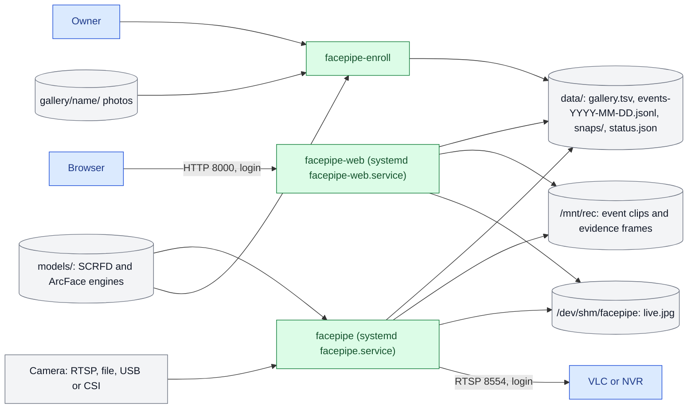
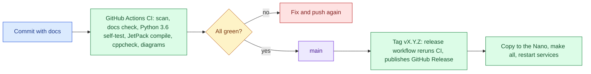

# Architecture

One Jetson Nano 4 GB runs everything. There is no server, no database service and no cloud dependency.

## How to read the diagrams

Colours are the same in every diagram here and in FLOW.md: blue for entry points (people and clients), green for steps this project runs, amber for decisions, purple for outcomes, red for errors, grey for data stores and services this project does not write. Solid arrows are in use; dotted arrows are optional, switched off, or not built yet.

## A1: Runtime topology

| Component | What it is | Runs as |
| --- | --- | --- |
| `facepipe` | C++ DeepStream 6.0.1 application: capture, detection, tracking, recognition, event log, video outputs, RTSP server | systemd `facepipe.service`, user `hamza` |
| `facepipe-enroll` | Same source built with `-DFACEPIPE_ENROLL`: photos to gallery | Run by hand |
| `web.py` | Python 3.6 standard-library HTTP server: dashboard, CSV, live view, evidence files | systemd `facepipe-web.service` |
| `models/` | SCRFD-10G (640x384) and ArcFace w600k_r50, ONNX plus TensorRT FP16 engines built on the device | Files |
| `data/` | `gallery.tsv`, `events-YYYY-MM-DD.jsonl`, `snaps/`, `status.json` | Files |
| `/mnt/rec` | 64 GB ext4 image-file volume for event clips and full-frame evidence | fstab loop mount |
| `/dev/shm/facepipe` | `live.jpg` and the `want` flag between facepipe and the web page | RAM |

Trust boundaries are the two network ports (8000 and 8554); see THREAT.md.

## A2: How a change reaches the device

Deploys are manual today (copy, `make all`, restart); the release workflow and versioning are in docs/RELEASING.md. Planned work is not drawn here; it is listed in HANDOVER.md.

## Hardware blocks used

| Block | Use |
| --- | --- |
| NVDEC | H.264 decode of RTSP and file sources |
| GPU (Maxwell, 128 cores) | SCRFD and ArcFace in TensorRT FP16, colour conversion, overlay |
| NVJPG | MJPEG decode for USB cameras; JPEG encode for the live view and evidence |
| NVENC | H.264 encode for RTSP and event clips |
| ISP (Argus) | CSI cameras |

See FLOW.md for the path of one face and DECISIONS.md for why each piece is the way it is.
