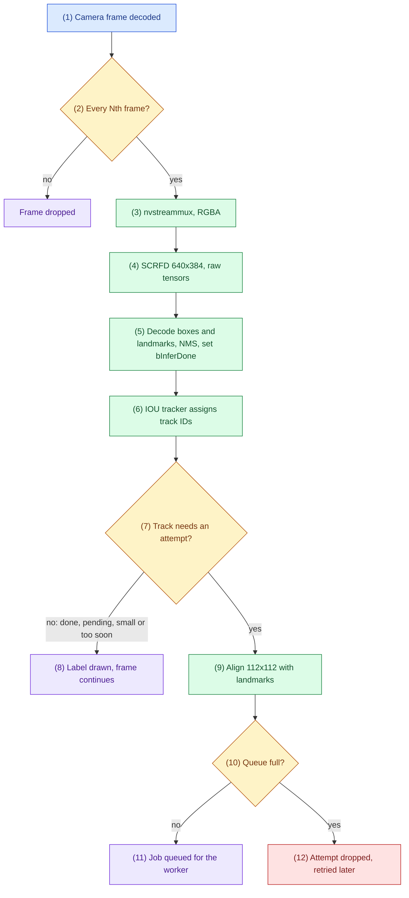
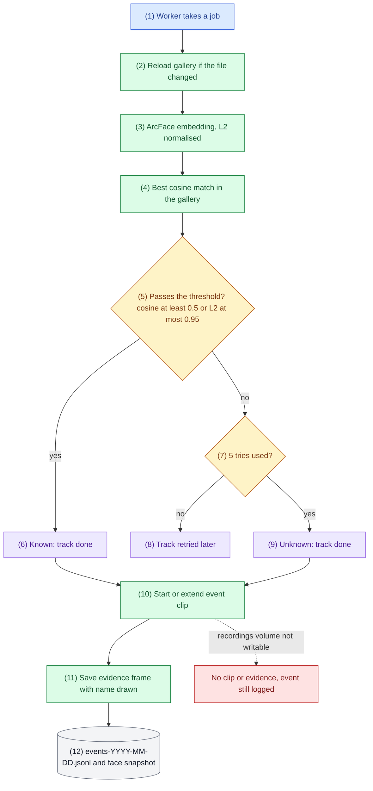
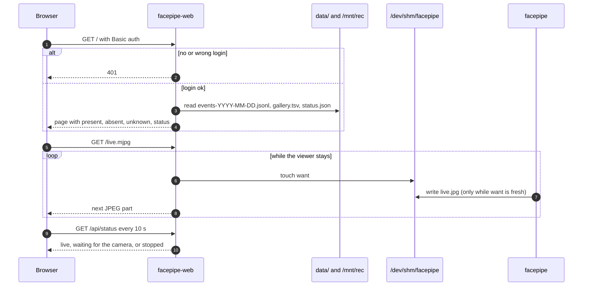
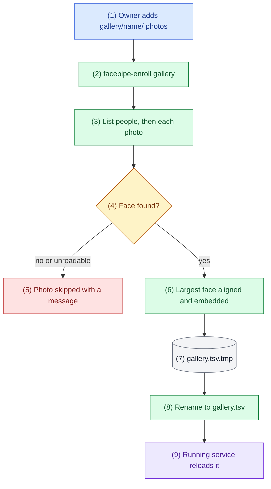

# Flows

Checked against the code of v1.0.3 (2026-11-06). When the code changes, fix the diagram, its key and its trace in the same commit.

## How to read the diagrams

Each section has a diagram, a key that maps names to code, and a numbered trace. The number in a box, written `(n)`, or the number on a sequence arrow, matches step n of the trace. Colours as in ARCHITECTURE.md: blue entry, green step, amber decision, purple outcome, red error, grey data store or service this project does not write. Solid arrows are in use; dotted arrows are optional or switched off.

## 1. Camera frame to a recognition attempt

Key: frame thinning `drop_probe`; detection `pgie_probe` and `decode_scrfd`; landmarks `pack_kps`/`unpack_kps`; attempt rule `want_attempt`; alignment `umeyama` and `align`; probe `tracker_probe` (all in `facepipe.cpp`); detector config `pgie_scrfd.txt`; tracker `tracker.yml` (IOU).

1. The frame is decoded by NVDEC (RTSP, file), NVJPG (USB MJPEG) or the ISP (CSI).
2. `drop_probe` on the nvstreammux sink keeps every Nth frame (`FACEPIPE_DROP`, default 2).
3. nvstreammux batches it; nvvideoconvert makes RGBA in GPU memory.
4. nvinfer runs SCRFD on a 640x384 letterbox (padded right and bottom) and attaches 9 raw output tensors.
5. `pgie_probe` decodes scores, boxes and 5 landmarks at strides 8, 16 and 32 (score 0.6 or more, NMS at IoU 0.4), adds one object per face with landmarks in `misc_obj_info`, and sets `bInferDone` so the tracker accepts them.
6. The IOU tracker gives each face a track ID after a short probation.
7. `want_attempt`: an attempt is due if the track is not done, nothing is pending, the face is at least 40 px wide, and 8 frames have passed since the last try.
8. Otherwise only the label is drawn (amber while recognizing, green name, red Unknown).
9. The face is aligned to the ArcFace 5-point template with a Umeyama similarity transform.
10. The worker queue holds at most 32 jobs.
11. The job carries the aligned face, track ID, box and detection score.
12. When the queue is full the attempt is dropped and the track tries again later.

## 2. Recognition to attendance event

Key: `rec_worker`, `Gallery::reload_if_changed`, `embed`, `Gallery::match`, `passes`, `l2_of`, `clip_trigger`, `save_evidence`, `log_event`, `write_bmp` (all in `facepipe.cpp`); settings `FACEPIPE_METRIC`, `FACEPIPE_MATCH`, `FACEPIPE_L2_MATCH`.

1. `rec_worker` waits on the job queue.
2. `gallery.tsv` is reloaded when its modification time changes, so enrollment needs no restart.
3. `embed` runs w600k_r50 on the RGB crop (x/127.5 - 1) and L2-normalises the 512-d result.
4. `Gallery::match` takes the highest cosine over all enrolled photos.
5. `passes` applies the chosen metric: cosine at least `FACEPIPE_MATCH` (default 0.5, default metric), or L2 distance at most `FACEPIPE_L2_MATCH` (default 0.95). Embeddings are normalised, so L2 = sqrt(2 - 2 cosine) and both metrics pick the same closest photo.
6. A match marks the track done with the person's name; the label turns green.
7. Below the threshold the try count decides.
8. Fewer than 5 tries: the track gets another attempt (FLOW 1, step 7).
9. On the 5th try the track is done as Unknown; the label turns red.
10. `clip_trigger` starts an MP4 clip from the ring buffer (3 s back) or extends the current one by 5 s.
11. `save_evidence` waits for the next annotated frame (name drawn) and writes it as a 1080p JPEG.
12. `log_event` writes a 112x112 BMP face snapshot and appends one JSON line with time, name, cosine score, metric, L2 distance, snapshot, frame and clip.

## 3. Dashboard and live view

Key: `Handler.do_GET`, `Handler.authorized`, `page`, `attendance`, `Handler.live`, `status` (`web.py`); `on_jpeg` (`facepipe.cpp`).

1. Every request carries HTTP Basic auth, checked against the PBKDF2 hash in `web_auth`.
2. Without a valid login the answer is 401.
3. With a login the page reads the day's events, the gallery and the status file.
4. The page shows present, absent and unknown people and the status badge.
5. Opening the live view requests the MJPEG stream.
6. The web server touches `want` every 3 s while the viewer is connected.
7. `on_jpeg` writes `live.jpg` only while `want` is less than 10 s old, so nothing is written when no one watches.
8. Each new frame goes to the browser as one part of the multipart response.
9. The status badge polls every 10 s.
10. Status comes from `status.json`: older than 20 s means stopped, below 0.5 fps means waiting for the camera.

## 4. Enrollment

Key: `enroll` (`facepipe.cpp`, built only into `facepipe-enroll`), `Engine`, `decode_scrfd`, `align`, `embed`.

1. One folder per person, a few clear photos each (front, slight left, slight right).
2. The separate binary is needed because OpenCV `imgcodecs` cannot share a process with `nvjpegenc` (bugs/libjpeg-abi-clash.md).
3. Folders are listed before the temporary file is created; unreadable folders are skipped (bugs/enroll-leak-and-crash.md).
4. SCRFD runs on a 640x384 letterbox of the photo.
5. Unreadable photos and photos without a face are skipped and counted.
6. The largest face is aligned and embedded exactly as in the live path.
7. Embeddings are written to a temporary file.
8. The rename is atomic, so the live service never reads half a file.
9. The worker sees the new modification time and reloads (FLOW 2, step 2).
