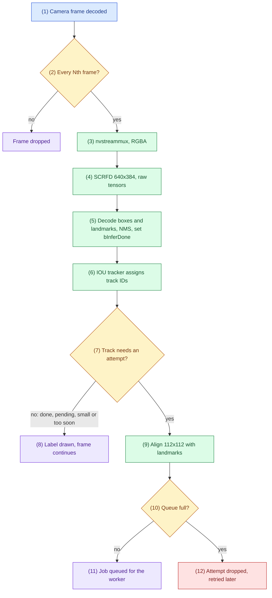
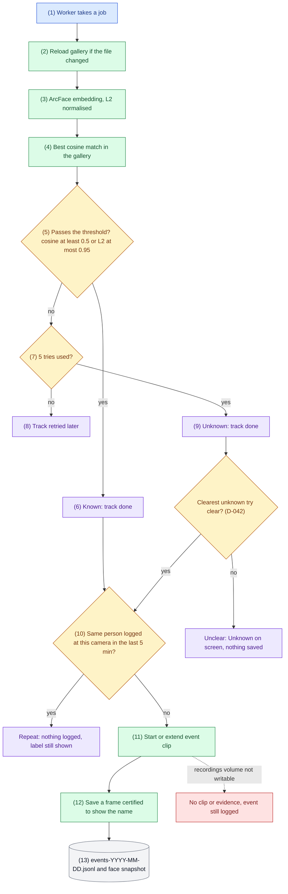
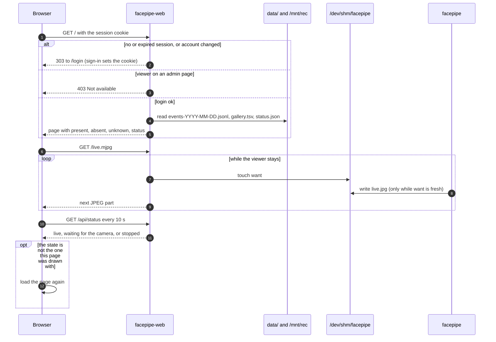
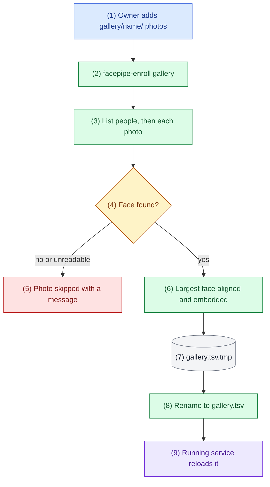
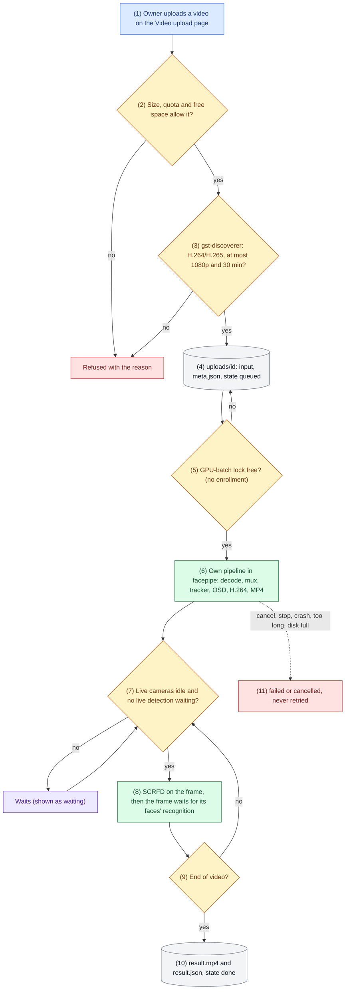
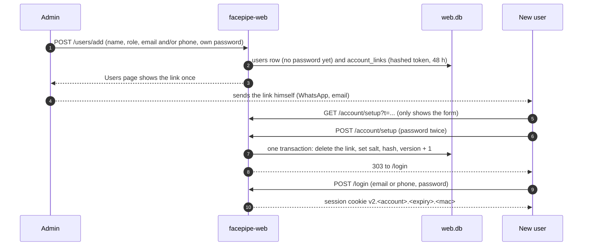

# Flows

Checked against the code of v1.13.7 (2026-11-07). When the code changes, fix the diagram, its key and its trace in the same commit.

## How to read the diagrams

Each section has a diagram, a key that maps names to code, and a numbered trace. The number in a box, written `(n)`, or the number on a sequence arrow, matches step n of the trace. Colours as in ARCHITECTURE.md: blue entry, green step, amber decision, purple outcome, red error, grey data store or service this project does not write. Solid arrows are in use; dotted arrows are optional or switched off.

## 1. Camera frame to a recognition attempt

Key: cameras `read_cameras`, `parse_cam_line`, `on_cam_pad`; frame thinning `drop_probe`; detection `detect_probe` (`detect_due`, `det_prepare`, `detect_frame`) and `decode_scrfd`; landmarks `pack_kps`/`unpack_kps`; attempt rule `want_attempt`; alignment `umeyama` and `align`; probe `tracker_probe` (all in `facepipe.cpp`); detector config `pgie_scrfd.txt`; tracker `tracker.yml` (IOU).

1. The frame is decoded by NVDEC (RTSP, file), NVJPG (USB MJPEG) or the ISP (CSI). With two network cameras (D-039) each has its own `nvurisrcbin` (TCP, reconnects a camera whose data stops for 10 s) on its own mux pad; the pad number is the camera index (`source_id`).
2. `drop_probe` on each nvstreammux sink keeps every Nth frame of that camera (`FACEPIPE_DROP`, default 2).
3. nvstreammux batches it (one frame per camera, 1280x720 with padding for two cameras); nvvideoconvert makes RGBA in GPU memory.
4. `detect_probe` decides per camera whether its frame gets detection (`detect_due`: every frame while that camera saw a face in the last 10 s, else every 6th). At most one SCRFD run per batch: two cameras both due take turns (D-039). A frame without detection goes on with `bInferDone` unset and the tracker only tracks it. SCRFD runs under `det_mu`, shared with uploads; a live caller goes first (FLOW 5).
5. `det_prepare` letterboxes the frame to 640x384 on the VIC (padded right and bottom) and normalizes it; SCRFD runs in TensorRT; `decode_scrfd` decodes scores, boxes and 5 landmarks at strides 8, 16 and 32 (score 0.6 or more, NMS at IoU 0.4), adds one object per face with landmarks in `misc_obj_info`, and sets `bInferDone` so the tracker accepts them.
6. The IOU tracker gives each face a track ID after a short probation. Tracks are keyed by camera, the camera's generation (raised when it comes back after a gap of more than 3 s) and the track ID.
7. `want_attempt`: an attempt is due if the track is not done, nothing is pending, the face is at least 40 px wide, and 8 frames have passed since the last try.
8. Otherwise only the label is drawn (amber while recognizing, green name, red Unknown).
9. The face is aligned to the ArcFace 5-point template with a Umeyama similarity transform.
10. The worker queue holds at most 32 jobs.
11. The job carries the aligned face, track ID, box and detection score.
12. When the queue is full the attempt is dropped and the track tries again later.

## 2. Recognition to attendance event

Key: `rec_worker`, `Gallery::reload_if_changed`, `embed`, `Gallery::match`, `passes`, `l2_of`, `repeat`, `seed_repeats`, `clip_trigger`, `certify_batch`, `offer_jpeg`, `save_evidence`, `log_event`, `write_bmp` (all in `facepipe.cpp`); settings `FACEPIPE_METRIC`, `FACEPIPE_MATCH`, `FACEPIPE_L2_MATCH`.

1. `rec_worker` waits on the job queues; live faces always go before upload faces. A result is applied only if its track is still pending under the same key (camera, generation, track ID); otherwise it is counted as `stale` and labels nothing.
2. `gallery.tsv` is reloaded when its modification time changes, so enrollment needs no restart.
3. `embed` runs w600k_r50 on the RGB crop (x/127.5 - 1) and L2-normalises the 512-d result.
4. `Gallery::match` takes the highest cosine over all enrolled photos.
5. `passes` applies the chosen metric: cosine at least `FACEPIPE_MATCH` (default 0.5, default metric), or L2 distance at most `FACEPIPE_L2_MATCH` (default 0.95). Embeddings are normalised, so L2 = sqrt(2 - 2 cosine) and both metrics pick the same closest photo.
6. A match marks the track done with the person's name; the label turns green.
7. Below the threshold the try count decides.
8. Fewer than 5 tries: the track gets another attempt (FLOW 1, step 7).
9. On the 5th try the track is done as Unknown; the label turns red. Only the clearest clear try of the track is logged (`face_quality`, `clearer`, D-042: frontal, eyes at least 28 px in camera pixels, not cut off, not dark); with none it is `unclear` and nothing is saved, and a later clear sample gets one more try (`extra_possible`, `take_extra`). Tries that fail before recognition are given back (`release_try`).
10. `repeat` applies the CCTV system's 5-minute rule (D-038), per camera (D-039): a name logged at this camera in the last 5 minutes, or an unknown face that would match an unknown logged in the last 5 minutes, writes nothing (no clip, frame, snapshot or event; counted as `repeats` in the fps log line). `seed_repeats` loads today's named events at start, so a restart does not log the same people again.
11. `clip_trigger` starts an MP4 clip from the ring buffer (3 s back) or extends the current one by 5 s.
12. Before the label can show, the worker registers an evidence request. `tracker_probe` lists every batch in which that camera had a fresh frame and the track carried the decided label (`certify_batch`); `on_jpeg` keeps the JPEG of exactly such a batch (`offer_jpeg`), and `save_evidence` writes it within 1.5 s or saves none. A later batch is not enough: the track may have left, and the tiler repeats a stalled camera's last picture without its labels.
13. `log_event` writes a 112x112 BMP face snapshot and appends one JSON line with time, name, cosine score, metric, L2 distance, snapshot, frame, clip, camera ID and camera name.

## 3. Dashboard and live view

Key: `Handler.do_GET`, `Handler.user`, `Server.session_principal`, `allowed`, `Handler.forbidden`, `page`, `attendance`, `Handler.live`, `status` (`web.py`); `on_jpeg` (`facepipe.cpp`).

1. Every request carries the session cookie set by `/login` (D-036): `v2.<account>.<expiry>.<mac>`; the account is the owner (`web_auth`) or a user from `web.db` (D-040). The MAC covers the account's version and password hash, so a role or password change or a deleted account signs it out.
2. Without a valid session a page redirects to `/login`; data, video and files answer 401. `allowed` then checks the exact path and method: a viewer gets 403 on People, Video upload, Users and every change; System and Cameras show without their controls.
3. With a login the page reads the day's events, the gallery and the status file.
4. The page shows present, absent and unknown people and the status badge.
5. Opening the live view requests the MJPEG stream.
6. The web server touches `want` every 3 s while the viewer is connected, and checks the session again then (downloads every 2 MB or 3 s).
7. `on_jpeg` writes `live.jpg` only while `want` is less than 10 s old, so nothing is written when no one watches.
8. Each new frame goes to the browser as one part of the multipart response.
9. The status badge polls every 10 s.
10. Status comes from `status.json`: older than 20 s means stopped, below 0.5 fps means waiting for the camera.
11. The poll writes only the badge. The banner on every page, the dot in the sidebar and the System page's figures and buttons are rendered by the server, so each page carries the state it was drawn with in `data-state`; when the polled state differs, the page loads itself again (v1.13.7). It waits while an input has focus, so a half-filled form is not discarded.

## 4. Enrollment

Key: `enroll` (`facepipe.cpp`, built only into `facepipe-enroll`), `Engine`, `decode_scrfd`, `align`, `embed`.

1. One folder per person, a few clear photos each (front, slight left, slight right).
2. The separate binary is needed because OpenCV `imgcodecs` cannot share a process with `nvjpegenc` (bugs/libjpeg-abi-clash.md).
3. Folders are listed before the temporary file is created; unreadable folders are skipped (bugs/enroll-leak-and-crash.md).
4. SCRFD runs on a 640x384 letterbox of the photo.
5. Unreadable photos and photos without a face are skipped and counted.
6. The largest face is aligned and embedded exactly as in the live path.
7. Embeddings are written to a temporary file.
8. The rename is atomic, so the live service never reads half a file.
9. The worker sees the new modification time and reloads (FLOW 2, step 2).

## 5. Video upload

Key: `upload_post`, `receive_upload`, `probe_video`, `parse_discoverer`, `cleanup_uploads`, `page_uploads`, `upload_action`, `run_enroll` (`web.py`); `upload_thread`, `run_upload`, `upload_detect_probe`, `upload_tracker_probe`, `det_mu`, `live_waiting`, `live_idle` (`facepipe.cpp`).

1. The page's script sends the file itself as the request body (progress bar), with the form token in `X-CSRF`.
2. `receive_upload`: at most 500 MB on the home network, 95 MB through the Cloudflare Tunnel (its free plan refuses bodies over 100 MB); at most 3 videos waiting; inputs and results under 4 GB together; 2 GB of the disk kept free, checked again while the file arrives.
3. `probe_video` runs `gst-discoverer-1.0` in its own process; a file it cannot read, another codec, more than 1920x1080 or more than 30 minutes is refused and deleted.
4. The checked file is renamed to `input`; `meta.json` records name, size, codec, size in pixels, duration and upload time.
5. `upload_thread` takes the oldest waiting video every 2 s, only while it can hold `data/gpu-batch.lock` (enrollment takes the same lock, so the two never run beside each other); state becomes `processing`.
6. `run_upload` builds a second pipeline in the same process (the SCRFD and ArcFace engines are shared; a second process would not fit in memory, D-039).
7. `upload_detect_probe` waits on `det_cv` until every live camera has been idle for 10 s and no live detection is waiting, and checks again after taking `det_mu`. People in view of a live camera hold uploads back; the page says so.
8. Every frame of the video is detected (no idle cadence). `upload_tracker_probe` queues new faces for recognition (served after live faces) and holds the frame until they are recognized, so the drawn label is the result.
9. `run_upload` watches the bus: cancel file, service stop, time limit (3 x the duration plus 2 min, not counting waiting), free space and output size every 2 s; it writes `progress.json` for the page.
10. On end of stream the MP4 is complete; `result.json` lists each recognized track (name, score, first and last second), the file is renamed and the state becomes `done`. The page offers the download.
11. Any other ending deletes the partial result. A video found `processing` at start was interrupted (stop or crash) and is marked failed, never retried, so a file that crashes facepipe crashes it only once (owner accepted, 2026-11-07). Uploads are deleted 7 days after upload (owner); an upload that never finished arriving goes after an hour.

## 6. User account: link, password, sign-in

Key: `page_users`, `users_post`, `issue_link`, `link_account`, `redeem_link`, `page_setup`, `Handler.setup_post`, `Handler.login_post`, `Server.find_login`, `Server.verify`, `Server.cooling`, `Server.acct_fail`, `norm_email`, `norm_phone`, `pw_problem`, `public_origin` (`web.py`).

1. Every Users-page change needs the admin's current password (`Server.verify`); the email is lower-cased, the phone must have `+` and a country code.
2. The account has no password yet; the link token is 128 bits, stored as a hash, one per account (a new one replaces the old).
3. The link is built from `FACEPIPE_PUBLIC_URL`, or shown as a path that the page completes with its own address.
4. The device sends nothing; the admin passes the link on.
5. Opening the link does not use it, so chat-app previews are harmless.
6. The password needs 15 to 256 characters and must not be the name, email or phone.
7. Deleting the link and storing the password happen in one transaction: of two simultaneous submissions only one succeeds.
8. The user is not signed in automatically.
9. `Server.find_login` finds the owner by user name or an account by email or phone; `Server.verify` hashes even for unknown names; after 5 failures the account pauses up to 30 s (`Server.cooling`).
10. The cookie's MAC binds the account, its version and its password hash.
